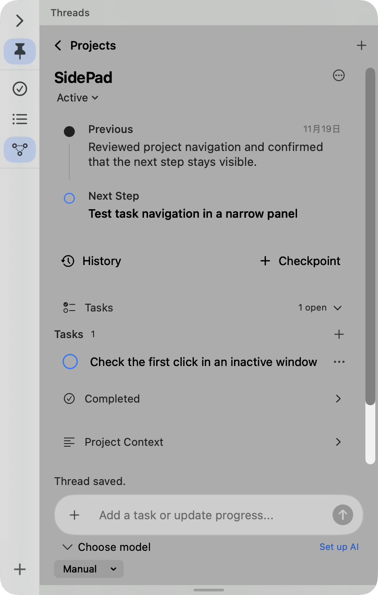

# SidePad

SidePad is a native macOS menu bar app that opens a workspace at the edge of your screen. Use it to check today's tasks, open a saved website, or pick up a project from the last checkpoint while keeping your main app in view.



## Key Features

- **Edge panel.** Reveal SidePad from either screen edge or the menu bar. Pin it in place or drag it into a floating panel. SidePad remembers workspace sizes and window placement.
- **Today and Inbox.** Add, edit, reorder, and complete tasks. Move work into Today or link tasks to a project in Threads.
- **Project memory.** Open a project in Threads to see where you stopped and what to do next. Save checkpoints offline, browse task activity and checkpoint history, and export a Markdown handoff.
- **Saved websites.** Open frequently used sites in the panel and control when each site goes to sleep. SidePad reuses a single WebKit view across sites.
- **Reviewable AI capture.** With a verified DeepSeek or compatible Codex CLI setup, turn a note into proposed task and project updates. Review the validated changes before applying them.

## Tech Stack & Architecture

The app is written in Swift and built with Swift Package Manager. An AppKit `NSPanel` hosts the SwiftUI workspace. `PanelController` handles presentation and docking, while `WindowGeometry` calculates window frames. Saved websites use `WKWebView`.

`WorkspaceStore` persists tasks, saved sites, and preferences in `UserDefaults`. `ThreadStore` keeps project context, activity, and checkpoints in local Markdown files with stable UUIDs. It checks for external edits before saving and journals multi-file changes for recovery. DeepSeek credentials are stored in macOS Keychain. The Swift package uses Apple frameworks and has no third-party package dependencies. [Markdown format and recovery](docs/threads/MARKDOWN_SCHEMA.md)

## Installation & Usage

Build with Xcode 26 or later for the macOS 26 SDK. The app targets macOS 14 and later. The build and demo were verified on macOS 26.

```sh
git clone https://github.com/stans3n/SidePad.git
cd SidePad
sh scripts/build-threads-app.sh
open '.build/SidePad Threads.app'
```

Click the SidePad menu bar icon to open the panel. Use the rail to switch between Today, Tasks, Threads, and saved websites. In Threads, open or create a project, set a next step, and choose **Checkpoint** when you pause. Manual tasks and checkpoints work without an account or API key.

To try the projects shown above with an isolated offline demo library, run:

```sh
sh scripts/build-threads-app.sh --demo-v2
open '.build/SidePad Threads V2 Demo.app'
```

Run `sh scripts/test.sh` for the Swift Testing suite. The default suite uses fixtures for external services. Live provider probes are opt-in.

## Development Status & Roadmap

- **Current.** The edge panel, task lists, saved sites, and local Threads V2 workflow are available in this prototype. The app is built locally from source.
- **Experimental.** AI capture includes a connection check and an explicit apply step. Provider tests use mock responses for this snapshot. The Notion adapter is covered by fixture tests and has no account connection flow in the app yet.
- **Next.** Add a reviewed Notion connection and verify real sync. Expand keyboard navigation and multi-display testing for the edge panel.

## AI-Assisted Development

I defined the product requirements and the Projects → Resume → History flow. I specified interaction details for inactive windows, narrow layouts, and checkpoint recovery, along with acceptance checks for those behaviors. I used Codex to help implement the app, debug macOS interaction issues, and develop automated tests.

## License

[MIT](LICENSE)
